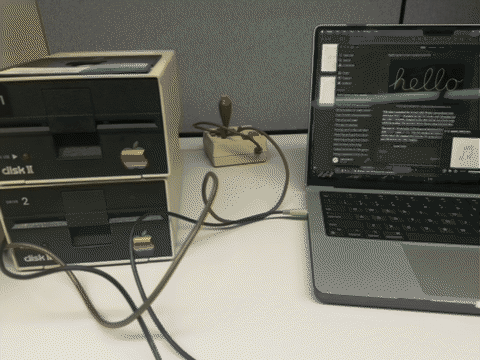
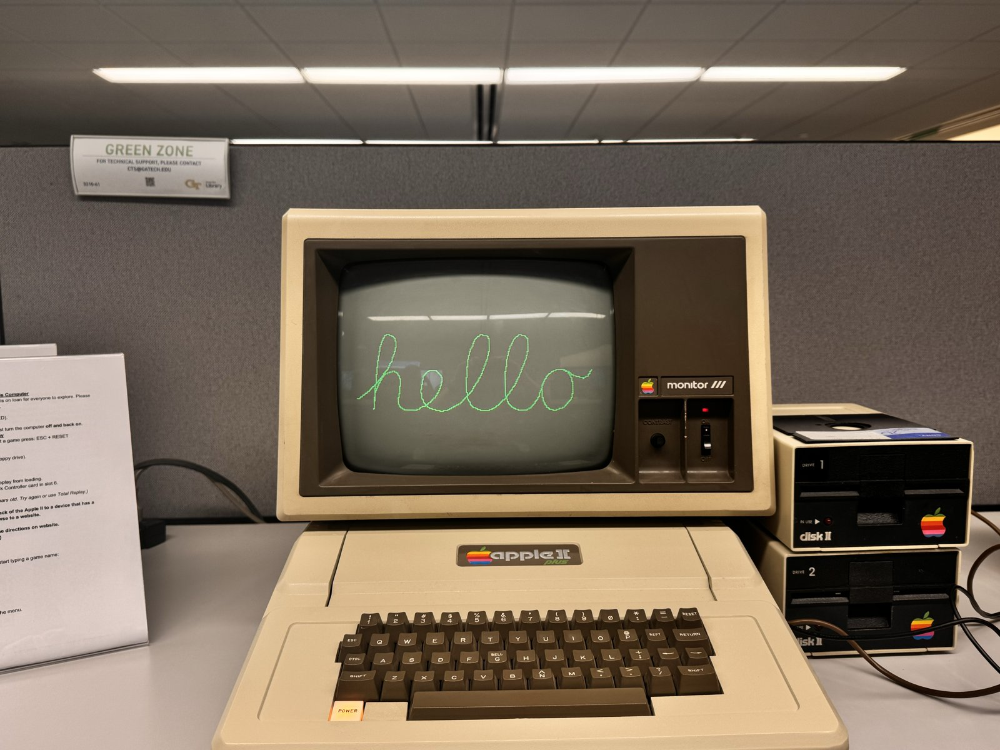

# Apple II cassette projects

Loading programs onto an Apple II through its cassette port, using a 3.5mm
cable from a Mac's headphone jack. Python scripts generate cassette-tape WAV
files in the Applesoft `LOAD` format, and a live Mac-to-Apple II screen mirror
streams lo-res frames over the same cable.



[Full video (MP4)](media/demo.mp4)



## Requirements

Python 3 and:

```bash
pip3 install Pillow numpy
```

The screen mirror also needs `mss` and `sounddevice`.

## Scripts

| Script | What it makes |
|---|---|
| `apple2tape.py` | Shared library: Applesoft tokenizer, cassette WAV encoder, lo-res palette and image helpers |
| `01_green_screen.py` | Fills the lo-res screen with green |
| `02_hello.py` | Mac-style cursive "hello" on hi-res, traced from Bezier curves with `HPLOT TO` |
| `03_red_monkey.py [img]` | Red monkey image, gamma + Bayer dither onto a warm 5-color ramp |
| `04_buzz.py [img]` | Georgia Tech Buzz logo with a navy/gold/white color classifier |
| `05_lumon_bounce.py [img]` | Lumon logo bouncing DVD-screensaver style, changing color on each bounce |
| `06_mirror_receiver.py` | 151-byte 6502 receiver for the live screen mirror |
| `stream_mac.py` | Mac side of the mirror: screen capture to FSK audio |

Each script writes a `.wav` (and image scripts a `_preview.png`) to the current
folder. Image scripts take a PNG, or a `.zip` containing one, as their argument.
The source images aren't in this repo.

The `apple2_*.wav` files are ready-made tapes from the original sessions:
`apple2_hello2.wav` (the hello drawing), `apple2_monkey.wav` and `apple2_buzz.wav`.

## Loading a tape

1. Connect the Mac headphone jack to the Apple II cassette **IN**.
2. At the `]` prompt type `LOAD`, then play the WAV (volume ~65–75%, audio effects off).
3. After the beep, type `RUN`. Ctrl+C or RESET stops it.

## Screen mirror

1. Load and `RUN` the tape from `06_mirror_receiver.py`. The screen switches to lo-res and waits.
2. On the Mac, run `python3 stream_mac.py`. Expect about 0.7 fps.

The receiver decodes FSK at twice the normal cassette speed (8 kHz cycle = `0`,
4 kHz cycle = `1`), waits for a `$A5` sync byte, then writes 960 bytes straight
into lo-res screen memory.

## How the tape format works

The Apple II Monitor ROM reads a 770 Hz header tone, a short sync cycle, then
data bits as single cycles: 2 kHz for `0` and 1 kHz for `1`, MSB first, ending
with an XOR checksum byte. Applesoft's `LOAD` expects two records: the program
length (2 bytes), then the tokenized program, which loads at `$0801`.
